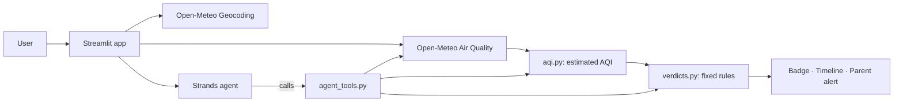
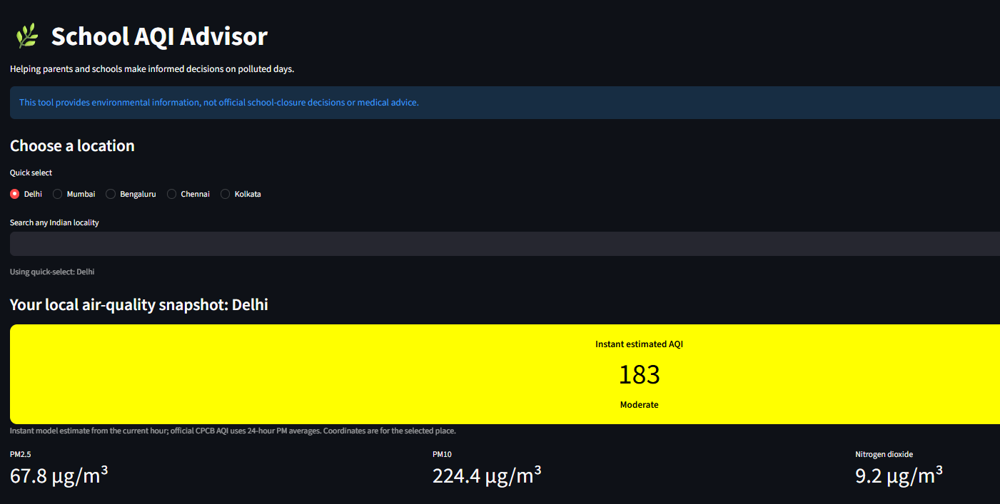
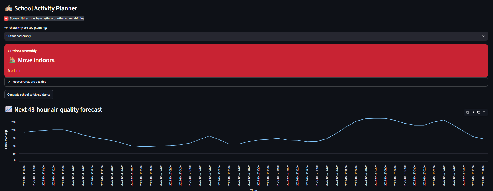
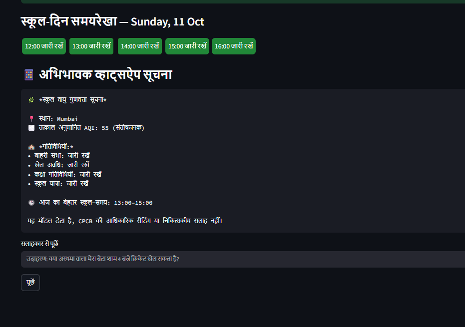

# 🌿 School AQI Advisor

**Tells schools and parents, in Hindi or English, whether kids can play outside today, and when the safest hours are.**

Built for **Environmental Hacks** (Bharat Builds Tour, WeMakeDevs × AWS), **Air track**.

[Demo video](https://www.youtube.com/watch?v=KqSfouGtk-w&feature=youtu.be) · [Blog on AWS Builder Center](https://builder.aws.com/content/3KXSH5r2Uv1uPcGYv9vcac7YoX7/can-the-kids-play-outside-today-building-a-school-air-quality-advisor-with-strands-agents)

<!-- Replace the three # links above with your real URLs before submitting. -->

---

## The problem

On bad-air days, a principal or parent has to answer a simple question: *should the kids go out for assembly, sports or the commute today?* Raw pollutant numbers (µg/m³) don't answer it, and most people can't read them. Parents often get a vague forward on WhatsApp, or nothing at all.

## What it does

Pick a place (any Indian locality) and get a clear answer in seconds:

- **Estimated AQI badge**, colour-coded on the Indian AQI scale (Good → Severe)
- **A verdict for each school activity**: ✅ Go ahead, ⚠️ Modify, or 🏠 Move indoors, for outdoor assembly, sports, classroom activities and the school commute
- **School-day timeline**: hour-by-hour verdicts from 7 AM to 4 PM, with the safest 2-hour window highlighted
- **48-hour forecast chart** of estimated AQI
- **Asthma / vulnerable-children mode** that makes every verdict one level stricter
- **Copy-ready WhatsApp message for parents**, in English or Hindi
- **Ask the advisor**: type a question like *"Can my son with asthma play cricket at 4 PM?"* and an AI agent answers using live data and the project's own verdict rules
- **Full Hindi interface**

## How it works: code decides, AI explains

The safety-critical parts are plain, tested Python. The AI never makes the call.

| Part | Who does it |
|---|---|
| AQI calculation (PM2.5 and PM10, CPCB-style breakpoints) | `aqi.py`, deterministic |
| Verdict for each activity | `verdicts.py`, a fixed rule table |
| Best 2-hour window | `forecast.py`, deterministic |
| Plain-language explanation and Q&A | AI agent, **cannot change the verdict** |

The advisor is a **[Strands Agents SDK](https://strandsagents.com)** agent with four tools: current air quality, forecast, AQI calculation and activity verdict. It must call the tools and quote the verdict unchanged, so it can't invent numbers. If the AI is unavailable, the badge, verdicts, timeline and parent message still work, with static precautions shown instead.



## Tech stack

- **Python** and **Streamlit** for the app
- **Strands Agents SDK** (AWS open source) for the tool-using agent
- **Gemini 2.5 Flash** as the model (swappable; Strands also supports Amazon Bedrock)
- **Open-Meteo** Air Quality and Geocoding APIs (free, no key needed)
- **Docker**, ready to deploy on AWS App Runner or Lightsail

## Run it locally

```bash
git clone <your-repo-url>
cd <your-repo-folder>

python -m venv .venv
# Windows: .venv\Scripts\activate     Mac/Linux: source .venv/bin/activate

pip install -r requirements.txt

cp .env.example .env        # Windows: copy .env.example .env
# open .env and paste your key:  GEMINI_API_KEY=your_key_here

streamlit run app.py
```

The AQI badge, verdicts, forecast, timeline and parent message **work without any API key**. The key is only needed for AI explanations and "Ask the advisor".

Run the tests:

```bash
python -m unittest
```

## Run with Docker

```bash
docker build -t school-aqi .
docker run -p 8080:8080 -e GEMINI_API_KEY=your_key_here school-aqi
```

Then open http://localhost:8080. The key is passed as an environment variable and is never baked into the image.

## Project structure

```
app.py            Streamlit interface
aqi.py            AQI calculation from PM2.5 / PM10
verdicts.py       Fixed activity verdict rules
forecast.py       Hourly forecast, best-window logic
data.py           Current air-quality fetch
locations.py      Indian place search
parent_alert.py   WhatsApp-style message
agent_tools.py    Tools used by the Strands agent
i18n.py           English / Hindi text
test_*.py         Unit tests
```

## Honest limitations

- **Values are model estimates, not station readings.** Open-Meteo provides modelled air-quality data, not CPCB monitor measurements.
- **The AQI is approximate.** It's computed from the current hour's PM2.5 and PM10. The official CPCB AQI uses 24-hour averages, so numbers can differ from official sources.
- **Place-level, not school-level.** Results are for the coordinates of the selected locality.
- **Verdicts are project rules, not official or medical guidance.** The thresholds are deliberately conservative and shown in the app under "How verdicts are decided".
- **This is decision support, not a closure order.** Always follow official advisories and school policy.

## Next steps

- Blend in the nearest CPCB / OpenAQ monitoring-station readings
- School-level locations and saved schools
- Automatic morning alerts to parent groups
- Amazon Bedrock as the default model

## Screenshots

| Estimated AQI and verdicts | School-day timeline | Hindi parent alert |
|---|---|---|
|  |  |  |

<!-- Save three screenshots into a screenshots/ folder with these names, or edit the paths above. -->

---

Built by [Aniket Guleria](https://www.wemakedevs.org/aniket404) for Environmental Hacks.
